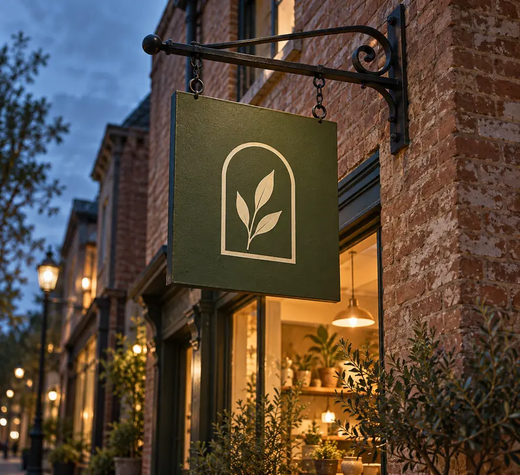

# Applications

Four places the mark has to work, mocked up to check scale and colour before anything is printed or painted. The mockup renders draw a looser version of the mark (an outlined arch with a leaf or sprig inside), so judge only scale, colour and placement in them. The vector in the [handoff](handoff.md) is the master.

## The tin

:::annotate[The tin]

- {#1 pin x=27.6% y=60% by=noor} The embossed mark needs a 1.5 mm stroke minimum or the kraft tears. The current drawing is at 2 mm. To confirm on the die maker's proof.
:::

One label template on three tin colours: moss for the house blend, clay for the second blend and oat for single-origin teas. The mark is **blind-embossed** into the kraft label rather than printed, so the only ink on the label is the tea's name and weight, in one of the two allowed spot colours. The emboss costs a one-off die and a second pass, but it saves the second ink, and it makes the tin look made, not branded.

## The sign

:::annotate[The sign]

- {#1 pin x=47.8% y=50.7% resolved by=noor} At the agreed 60 cm sign size the leaf stem, the thinnest part of the mark, comes out at 14 mm, comfortably above what the signwriter can pull cleanly (confirmed with her in round 2).
- {#2 pin x=68% y=67.2% by=noor} The shop name goes on the window vinyl, so the sign can be seen from the far side of the street. The warm window does half the work.
:::

Moss ground, oat mark, no words. This is the test from the brief: recognise the shop without reading.

## The ordering app

:::annotate[The ordering app]

- {#1 region x=23.1% y=62.8% w=24.4% h=17.4% by=noor} The photos in the cards are the shop's own teas, to be taken in the same low light as the [moodboard](moodboard.md). These are placeholders.
- {#2 pin x=72.7% y=39.5% by=noor} Every tappable area is at least 44 × 44 pt on iOS and 48 × 48 dp on Android. Still to check against the developer's components.
:::

Oat background, moss for the primary button, clay only for small accents because its contrast is too low for small text. Text in this mockup is placeholder bars; the developer will use the typefaces from the handoff.

## The tasting-night poster

:::annotate[The tasting-night poster]

- {#1 region x=0% y=69.9% w=100% h=30.1% by=noor} The bottom third stays empty for the date, which changes every month, so Dana can set it herself in the template.
- {#2 pin x=79.8% y=19.2% by=noor} Charcoal, in the moon.
:::

A cut-paper collage in the three palette colours plus charcoal. A different illustration each month, the same bottom third.

## What I would change

The tin works and the sign works. The app is the weakest because I have not seen the developer's component library yet: it is a direction, not a design. I have flagged it for review rather than approving it.
