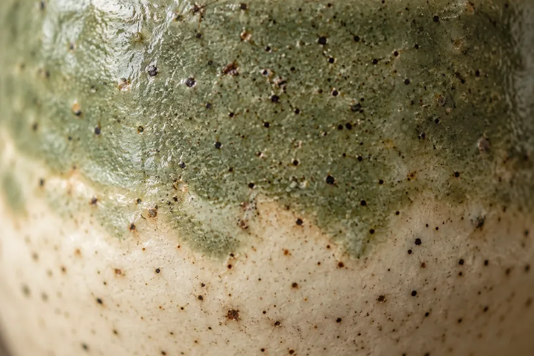
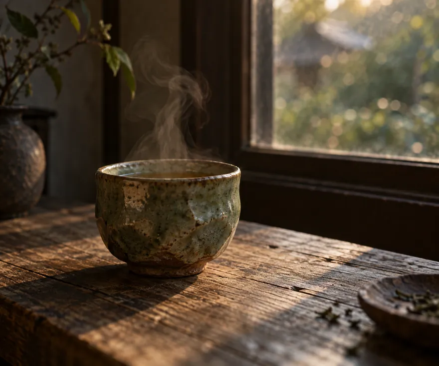
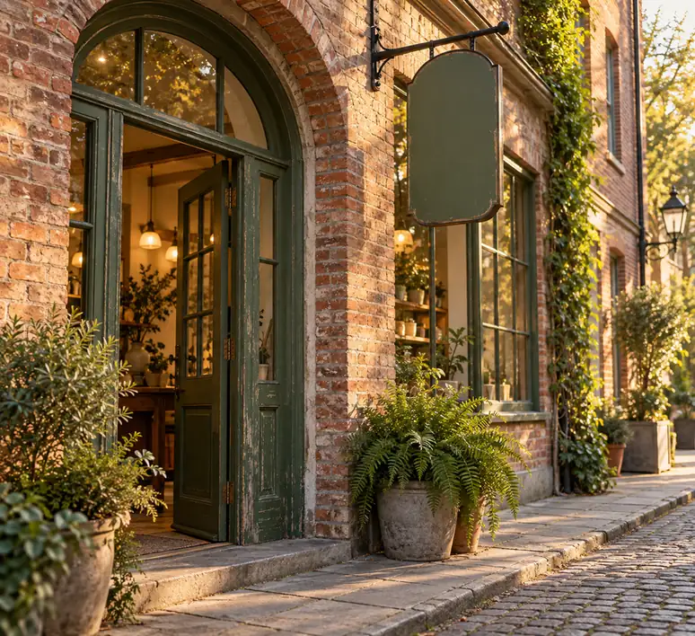

# Moodboard

The board Dana approved before I drew anything. Four images, each there for one reason. The first three were photographed or sourced for the board; the last is the arched doorway she already owns.

**Glaze.** The surface I keep coming back to: green that is not quite even, with specks where the clay shows through. If the tin or the sign feels like this, it is right.

**Materials and palette.** Everything on the cloth is something Dana already handles: leaf, clay, paper, fern. The four colours I will build from sit in this picture: moss, clay, oat and a near-black for text.

**Light and mood.** Low, warm, a little dim. The photography she will commission later should look like this and not like a bright white studio.

**The doorway.** The one thing she already has. It is arched, it is green and it is the shape people will see first, so it becomes the first candidate for the mark.

## Keywords

Warm, domestic, hand-made, uneven on purpose, quiet.

## Not this

- Cold minimal white and sage (it looks like every wellness brand on the high street).
- Gold foil and crests.
- Anything that needs the owner to explain it.

## Palette, first pass

| Name | Hex | Where it is used |
| --- | --- | --- |
| Moss | `#596B43` | Sign, the house-blend tin, the mark |
| Clay | `#B9694E` | Accents, one tin colour, the poster |
| Oat | `#F0E9D8` | Paper, backgrounds, text on moss |
| Charcoal | `#30312D` | Body text |

Under *Compilations*, the **Moodboard wall** puts the four images side by side as thumbnails, which is how I show the board on a call.

*This is a sample notebook from [MyGitNotes](https://mygitnotes.com/). [What this example shows](https://mygitnotes.com/use-cases/designer).*
