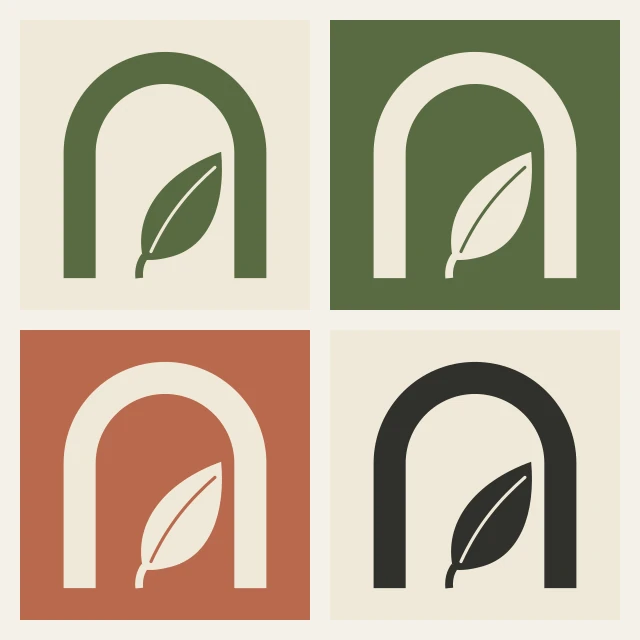

# Round 2: refining the gate

One mark only now. This round answers [Dana's six comments](client-feedback-r1.md), and I tested it where it will actually live: in colour, at small sizes and in ink.

## What changed

- **The leaf stands.** It grows from the baseline between the two legs instead of floating (comment 2). This also pulls the shape away from a lowercase "n" (comment 5): the five people I showed it to this morning all said "a door with a plant", and none said a letter.
- **Heavier arch.** The stroke is about a seventh thicker (comment 3). At the agreed 60 cm sign size the thinnest part of the mark, the leaf stem, comes out at 14 mm, comfortably above what the signwriter can pull cleanly. She confirmed it, and the sign uses the plain leaf without the midrib.
- **Colour has rules** (comment 4), set out below.

## Colourways

:::annotate[Where each colourway goes]

- {#1 region x=3.1% y=51.6% w=45.3% h=45.3% by=noor} Answers Dana's comment 4 ("moss everywhere feels sleepy"): clay is the ground and oat the mark. Mark and large shapes only, because this pair reaches only 3.3 : 1, enough for large shapes but not for small text.
- {#2 region x=51.6% y=3.1% w=45.3% h=45.3% by=noor} The reversed pair, for the sign and the house-blend tin.
- {#3 region x=3.1% y=3.1% w=45.3% h=45.3% by=noor} The default: moss on oat, for text and mark.
- {#4 region x=51.6% y=51.6% w=45.3% h=45.3% by=noor} Charcoal on oat, for body text only.
:::

Contrast checked with the WCAG formula, since the same colours will end up on the app:

:::bars{title="Contrast of each colour pair" unit=": 1" reference="4.5" reference-label="WCAG AA for body text" max="12"}
- Moss on oat｜4.8｜Default. Text and mark.
- Oat on moss｜4.8｜Sign, house-blend tin, dark screens.
- Charcoal on oat｜10.8｜Body text only.
- **Oat on clay**｜3.3｜**Mark and large shapes only.** Never body text.
:::

Clay is a warm accent, not a text colour. That answers "moss everywhere feels sleepy" without making the app hard to read.

## Small sizes, in ink

:::annotate[Trial stamp at three sizes]

- {#1 region x=14.2% y=29.8% w=27% h=44% by=noor} 12 mm: the mark holds, midrib clear.
- {#2 region x=48% y=49.1% w=16.6% h=27.3% by=noor} 8 mm: the leaf's midrib starts to close up. Between 8 and 12 mm we use the plain leaf with no midrib.
- {#3 region x=71.4% y=63% w=9.1% h=14.3% by=noor} 5 mm: the midrib is down to a faint hairline and barely reads. Below 8 mm we do not use the mark at all.
- {#4 pin x=82% y=18.7% by=noor} The trial stamp is cut from a looser outlined version of the mark, so read the impressions for size and ink, not for the exact shape.
:::

A trial stamp, pressed on the kraft stock the labels will use. It is cut from a looser outlined version of the mark, so read it for size and ink, not for the exact shape. The mark holds at 12 mm. At 8 mm the leaf's midrib starts to close up and at 5 mm it is only a faint hairline, so between 8 and 12 mm we use the plain leaf with no midrib, and below 8 mm we do not use the mark at all. The fern seal from round 1 stays a large stamp on lids and bag closures (comment 6), not a small-size substitute.

## Still open

- Five more people for the "n" test, ideally ones who have not seen the name. If anyone says a letter, the arch needs to get taller.
- The leaf curve is still the version I drew on the train. I will redraw it properly in the vector file before the handoff.

Next: [Applications](applications.md).
