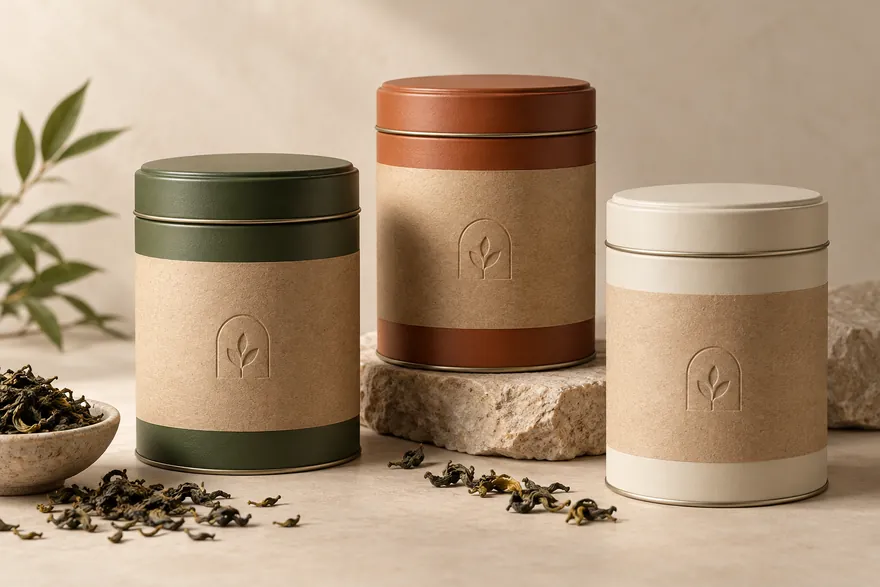
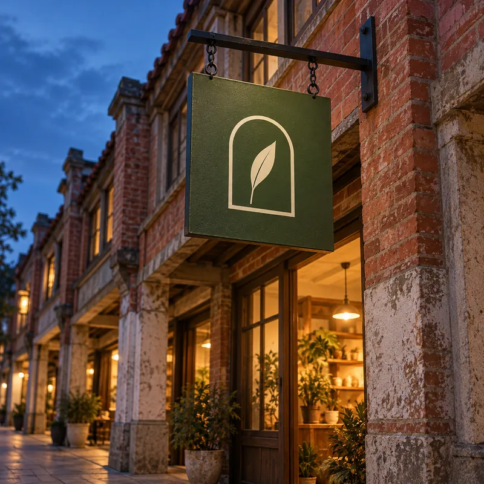
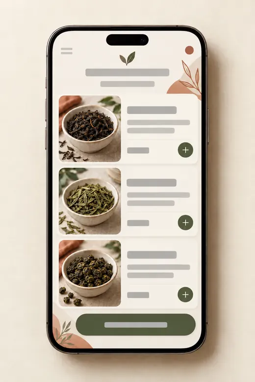
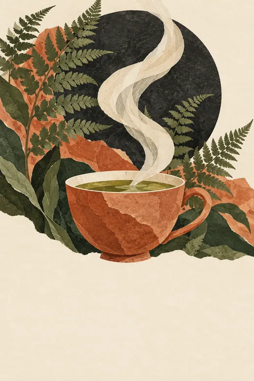

# 應用延伸

標誌一定要撐得住的四個地方，先做擬真圖確認比例和顏色，再去印或去畫。擬真圖畫的是比較鬆散的標誌版本（外框描線的圓拱，裡面一片葉子或一小枝），所以只看比例、顏色和位置。以[交付清單](handoff.md)裡的向量檔為準。

## 茶罐

:::annotate[茶罐]

- {#1 pin x=27.6% y=60% by=亦安} 壓凸的標誌線寬至少要 1.5 mm，否則牛皮紙會裂。目前設計稿是 2 mm。等刀模廠打樣再確認。
:::

同一張標籤版型，配三種罐色：苔綠給自家配方茶，陶土紅給第二款配方，燕麥白給單一產地茶。標誌是**無色打凸**在牛皮紙上，不是印刷，所以標籤上唯一的油墨是茶名和重量，兩個容許的專色裡只用一個。打凸要多付一次性的刀模費和一道加工，但省下第二個顏色的油墨，罐子看起來也是「做出來的」，不是「貼了品牌」。

## 招牌

:::annotate[招牌]

- {#1 pin x=51.9% y=40.6% resolved by=亦安} 在談好的 60 cm 招牌尺寸下，標誌最細的地方（葉柄）是 14 mm，遠高於招牌師傅畫得乾淨的下限（第二輪已和她確認）。
- {#2 pin x=70% y=65% by=亦安} 店名放在玻璃貼上，這樣招牌才能讓人隔著馬路看見。下方暖暖的櫥窗光，替它做了一半的工作。
:::

苔綠底、燕麥白標誌，招牌上沒有字。這就是需求書的測試：不用讀字就認得出這間店。

## 訂購 App

:::annotate[訂購 App]

- {#1 region x=23.1% y=62.8% w=24.4% h=17.4% by=亦安} 卡片裡的茶葉照片要用店裡實際的茶，在[情緒板](moodboard.md)那種低光源下拍。這裡先用佔位照片。
- {#2 pin x=72.7% y=39.5% by=亦安} 每個可點擊區域在 iOS 至少 44 × 44 pt、在 Android 至少 48 × 48 dp。還要對照工程師的元件庫檢查。
:::

燕麥白底，主要按鈕用苔綠，陶土紅只用在小面積點綴，因為它當小字的文字色對比不夠。這張擬真圖裡的文字是灰色佔位條，工程師會用交付清單裡指定的字體。

## 品茶夜海報

:::annotate[品茶夜海報]

- {#1 region x=0% y=69.9% w=100% h=30.1% by=亦安} 底部三分之一留空，給每個月都會變的日期，周老闆可以自己在版型裡更新。
- {#2 pin x=79.8% y=19.2% by=亦安} 炭黑用在月亮上。
:::

用調色盤三個顏色加炭黑做的剪紙拼貼。每個月換一張插畫，底部三分之一不動。

## 我會再改的地方

茶罐和招牌都過關。App 最弱，因為我還沒看到工程師的元件庫：這只是方向，不是設計稿。所以我把它標成待審閱，沒有直接定案。
