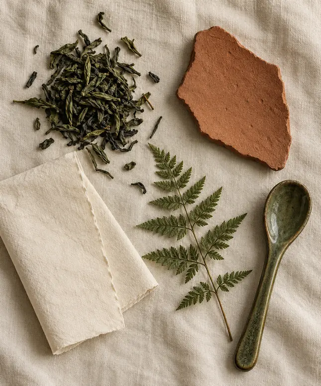
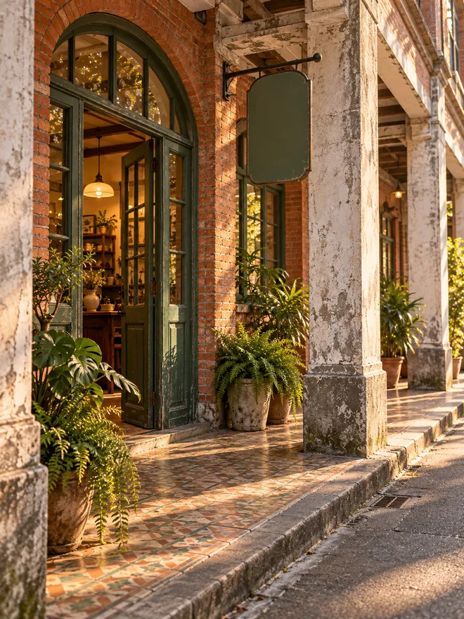

# 情緒板

這是周老闆在我動筆畫任何東西之前就點頭的版面。一共四張圖，每張只負責一件事。前三張是為情緒板拍攝或蒐集的，最後一張是她本來就有的拱形門框。

**釉面。** 我一再回頭看的質感：綠得不太均勻，帶著陶土透出來的斑點。茶罐或招牌只要摸起來像這樣，就對了。

**材料與色彩。** 布上每一樣東西都是周老闆日常會碰到的：茶葉、陶土、紙、蕨葉。我接下來要用的四個顏色就在這張圖裡：苔綠、陶土紅、燕麥白，和一個近黑的文字色。

**光線與氣氛。** 低、暖，有點暗。之後她請人拍的商品照，應該像這張，而不是亮白的攝影棚。

**門框。** 這是她手上唯一已經有的東西。它是拱形的、是綠色的，也是行人第一眼會看到的形狀，所以順理成章成為標誌的第一個候選。

## 關鍵字

溫暖、家常、手作、刻意的不均勻、安靜。

## 不要這樣

- 冷冷的極簡白加鼠尾草綠（看起來像街上每一家養生品牌）。
- 燙金和徽章。
- 任何需要老闆開口解釋才看得懂的東西。

## 色彩，第一版

| 名稱 | 色碼 | 用在哪裡 |
| --- | --- | --- |
| 苔綠 | `#596B43` | 招牌、自家配方茶罐、標誌 |
| 陶土紅 | `#B9694E` | 點綴色、其中一款茶罐、海報 |
| 燕麥白 | `#F0E9D8` | 紙張、背景、苔綠底上的文字 |
| 炭黑 | `#30312D` | 內文 |

在「合輯」裡有一個「情緒板牆」，把這四張圖用縮圖並排，開會時我就是這樣給業主看的。
