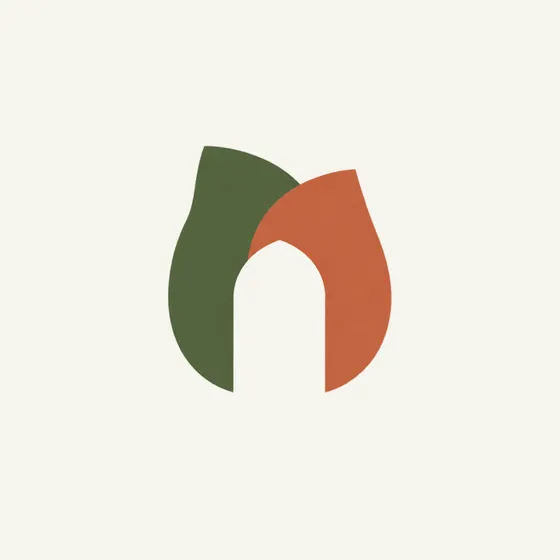

# 第一輪：三個方向

三個標誌，我盡量畫得簡單，各自用不同方式回應前期調查。全都放在白底上，這樣被評斷的只有形狀本身。

## A. 門與葉

拱形的門，門裡站著一片葉子。它直接來自[門框](moodboard.md)，業主不需要我多解釋。

## B. 蕨葉印章

圓形印章，中間是一片蕨葉。為印章、罐蓋和袋口設計，也是三個裡面最「植物」的一個。

## C. 雙葉

兩片葉子疊在一起，中間的空隙就是拱門。三個裡面唯一用到兩種顏色的，也是唯一把點子藏起來的。

## 內部評圖

我找小薇坐了一小時，她是專職設計師，但從沒看過這個案子。我先講明這次是**方向評圖**（這個想法對不對？），不是細節評圖（曲線順不順？），才不會第四天還在爭字距。她先安靜看了五分鐘情緒板和三個標誌，然後才開口。

### 談 A

:::annotate[評圖：標誌 A]

- {#1 pin x=50% y=23.8% by=小薇} 拱形先被看成門，才被看成標誌。很好。
- {#2 pin x=52.1% y=59.8% resolved by=小薇} 葉子現在的位置，讓整個圖遠看有可能被當成小寫的「n」。提案前要在招牌尺寸上試一次。
- {#3 pin x=70% y=67.9% by=小薇} 線條夠粗，手繪也撐得住。
:::

### 談 B

:::annotate[評圖：標誌 B]

- {#4 region x=35.7% y=22.9% w=29.5% h=54.5% by=小薇} 蕨葉很漂亮，但邊緣有三十個上下。縮到茶罐蓋上 12 mm 時，印出來會糊成一團。
- {#5 pin x=18.9% y=50% by=小薇} 這是街上其他茶行最可能選的一個。沒有不好，但也沒有特別屬於苔門的地方。
:::

### 談 C

:::annotate[評圖：標誌 C]

- {#6 pin x=50.4% y=53.6% by=小薇} 重疊的想法很聰明，不過也像火焰或鬱金香。要有人告訴你，才看得出門。
- {#7 pin x=62.5% y=46.8% by=小薇} 每張標籤都要多印一次專色，對一間第一年的店來說太貴。
:::

## 決定

三個都提，**主打 A**，並明白告訴業主我推薦它。B 留作輔助印章（圓形印章可以放在罐蓋和袋口，不和門搶戲），C 放掉。

提案前還要處理的事：照評圖第 2 點，在招牌距離下測試 A；另外把葉子重畫，讓它明確是一片葉子，不是一筆線。

下一步：[業主對第一輪的回饋](client-feedback-r1.md)。

*這是 [MyGitNotes](https://mygitnotes.com/zh-tw) 的範例筆記本。[這個範例在示範什麼](https://mygitnotes.com/zh-tw/use-cases/designer)。*
