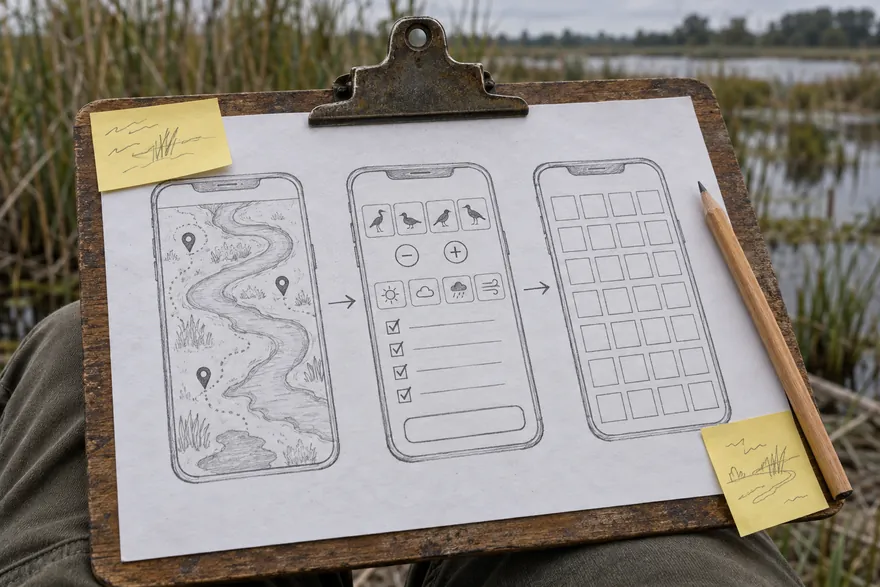
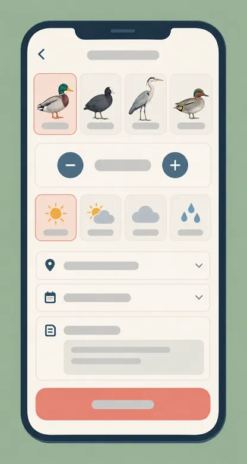
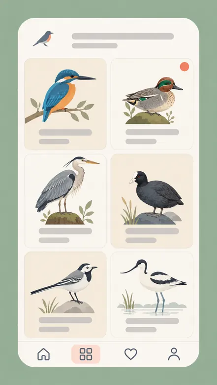

# Twiglog: a bird journal with buttons big enough for touchscreen gloves

**Mobile app design, eight weeks.** In testing, logging a sighting dropped from a median of 48 seconds to 19.

## The problem: birders log at their desk, a day late

The Saltreed Fen Watchers are a volunteer group who count birds across a wetland reserve. Their members wrote sightings in a notebook and typed them up at home, so records were a day late and half the details were gone. The apps they had tried were built for a desk: long forms, a species search that needs a keyboard, and a screen you cannot read in sun.

## My role

I led the product design: research on site, paper wireframes, the interface and a clickable prototype, plus the visual style. One developer built it and one volunteer ornithologist kept the species list honest. I did not write the code or decide what the group does with the records.

## The process

### We watched people log before we drew anything

I spent two mornings on the reserve with five members. Three things were true every time: they try to log before the bird leaves view, they wear touchscreen gloves for half the year, and mobile signal is patchy near the water. A sighting has to be loggable in about the time it takes to lose sight of a bird.

### Paper first, with the people who would use it

Three phones on one sheet: the map, the new-sighting form and the collection. We went round the reserve with the sheet and a pencil, and members ticked boxes on it. Moving the species choice to the top of the form came out of a ten-minute walk.

:::annotate[The paper wireframes]

- {#1 region x=17% y=29% w=21.6% h=53.2%} The map: where the reserve's hides and paths are, and where a sighting was made.
- {#2 region x=39.3% y=27.8% w=22.5% h=51.4%} The new-sighting form, with the species row first.
- {#3 region x=60.6% y=26.9% w=22.5% h=48.4%} The collection grid.
- {#4 pin x=45.9% y=37.8%} Moving the species choice up here came out of a ten-minute walk with the sheet and a pencil.
:::

### Pictures for species, big buttons for counts

Typing "great crested grebe" with cold fingers is miserable. So the form opens on a row of illustrated species chips for the birds a member logs most, with the full list one tap away. The count has a large plus and minus, and weather is one tap from four icons.

:::annotate[The new-sighting form]

- {#1 region x=13.5% y=15.6% w=72.6% h=13.6%} Illustrated species chips for the birds a member logs most. The full list is one tap away.
- {#2 region x=14.4% y=31% w=70.4% h=11.5%} The count is a large plus and minus, with room for a cold thumb.
- {#3 region x=14.4% y=41.8% w=70.4% h=10.3%} Weather is one tap from four icons.
- {#4 region x=14.4% y=83.6% w=70.9% h=9.2%} One coral save button, the only strong colour on the screen.
:::

### The collection is the reward

The only gamified part is a grid that fills up with the birds a member has logged. A small coral badge marks a new species. It never nags.

:::annotate[The collection]

- {#1 pin x=85% y=18.2%} A small coral badge marks a new species. It never nags.
- {#2 region x=11.1% y=15% w=78% h=73.3%} A grid that fills up with the birds a member has logged. The only gamified part of the app.
:::

## What I rejected, and why

- **Identify a bird from a photo.** Lovely idea, wrong place: by the time you have taken the photo, the bird has gone. The group preferred honest "unsure" entries to confident wrong ones.
- **A social feed.** The members said plainly that they do not want to see each other's lists, only the reserve's totals.
- **Colour-coding for rarity.** It made people log the rare ones and skip the sparrows, which hurts the count.

## The outcome

:::key-numbers{title="In prototype testing, 5 members"}
- 19 s｜Median time to log one sighting｜48 s before
- 4 of 5｜Logged before the bird left view｜1 of 5 before
- 0 of 10｜Entries with no species recorded｜3 of 10 before
:::

The beta went to the group's 212 members in spring. The treasurer asked for the weekly totals export before anything else, so that is the next piece of work.

Under *Compilations*, **Twiglog screens** puts the wireframe sheet and the three final screens in one row.

*This is a sample notebook from [MyGitNotes](https://mygitnotes.com/). [What this example shows](https://mygitnotes.com/use-cases/portfolio).*
