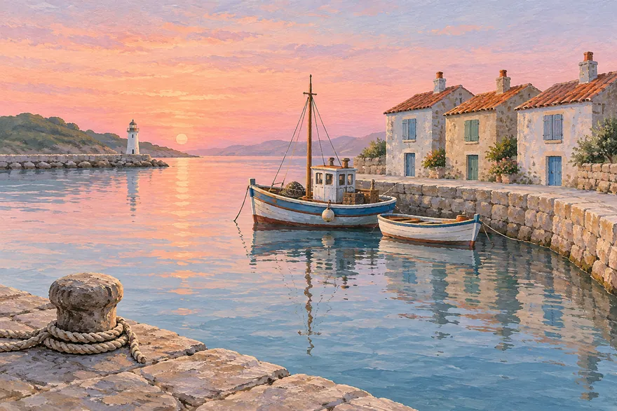
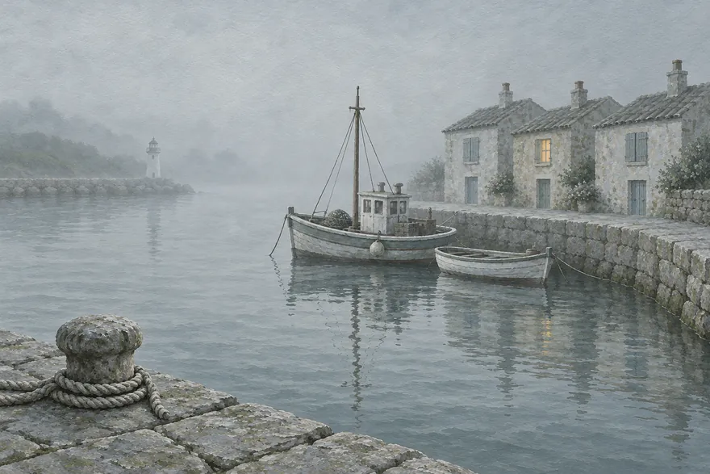
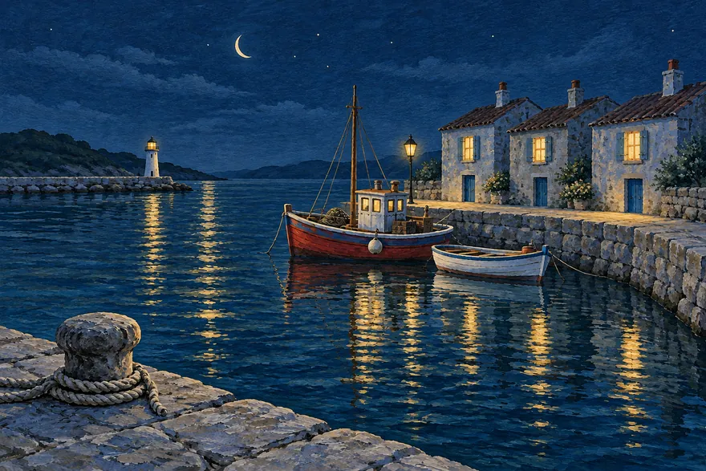

# Small Harbours

One harbour, painted four times in one day. A personal series in gouache on cotton paper, A4, each with its own limited palette.

## Dawn

Pink and pale blue, still water, the rope on the quay in the foreground. The warmest of the four and the one I painted first, to set the harbour's shape.

## Midday

Turquoise, cobalt, yellow ochre and a touch of red, plus white. I wanted the quay stones to feel hot, so I let the shadows go deep blue instead of grey.

## Fog

Greys and sage, with one warm lamp as the only bright spot. The quietest of the set and the one people ask about first.

## Night

Ink blue and teal against yellow lamps, with one red boat as a small surprise. The reflections are painted wet-on-wet in a single pass, so I painted this one three times before I kept it.

## How the series works

- **Same view, different light.** The harbour layout stays put. What changes is the time, the weather and the palette.
- **A palette per painting.** Three or four colours plus white, mixed in advance, so the painting cannot drift.
- **No people.** The harbour belongs to the boats.

## Prints and commissions

Giclée prints on cotton rag paper, A4 and A3, in an edition of 50 per picture. A custom harbour, a village you love painted at the time of day you remember it, takes about three weeks.

Under *Compilations*, **Small Harbours** lays the four paintings out in a row so the day reads from left to right.

*This is a sample notebook from [MyGitNotes](https://mygitnotes.com/). [What this example shows](https://mygitnotes.com/use-cases/portfolio).*
