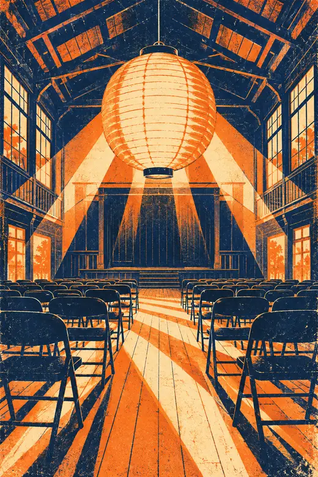
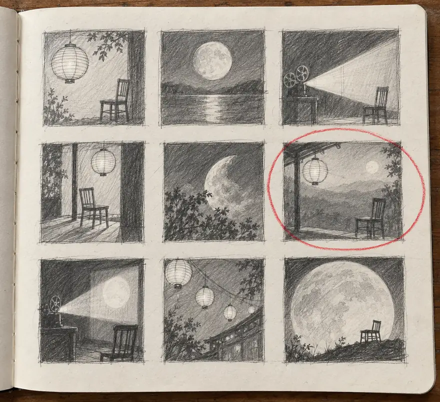
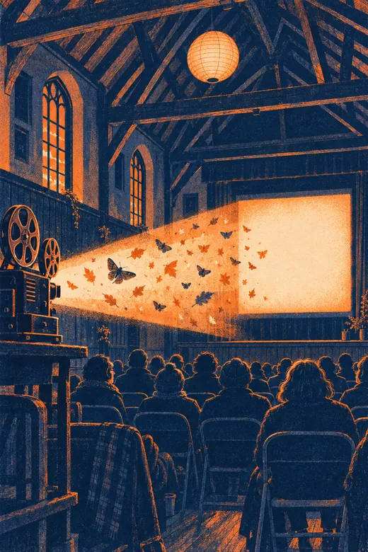
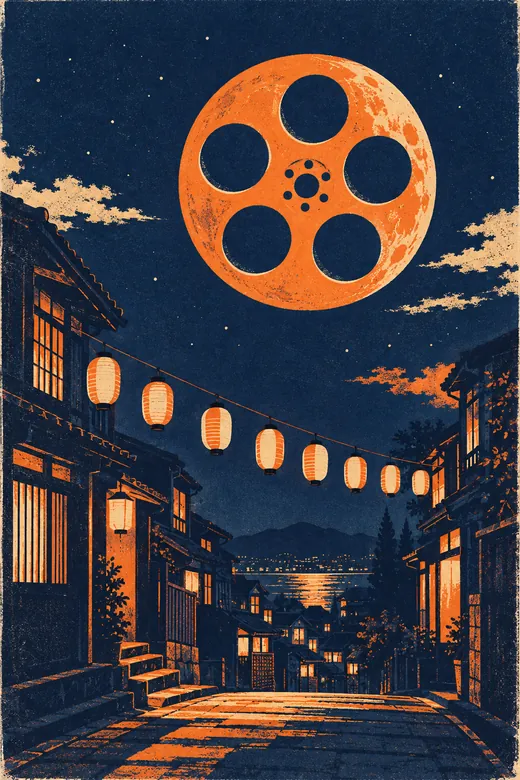

# 燈火影廳放映會：三張讓社區禮堂坐滿人的海報

**系列海報，兩色油墨印在米白紙上，三週。** 這一季四場放映有三場滿座，上一季一場也沒有。

:::annotate[開幕夜海報]

- {#1 pin x=50% y=25.6%} 圈起來的那張小稿裡的燈籠。
- {#2 region x=0% y=58.3% w=100% h=41.7%} 那張空椅子排成了一排排：禮堂等著它的觀眾。
:::

## 問題：影廳的宣傳看起來像跳蚤市場

燈火影廳是志工經營的社區放映空間，借用一間可容納 120 人的活動中心禮堂。前兩季的場次都靠影印傳單宣傳，來的人也都是原本就知道的人。策劃人方筱雯希望秋季檔期看起來像一場活動，但預算有限，連劇照的授權費都付不起。

## 我的角色

我是唯一的設計師，從構想、完稿到印刷檔都由我負責，直接和方筱雯、還有經營在地印刷工作室的志工阿傑對接。片單和文案不是我決定的。

## 過程

### 先畫九張小稿，才挑出一張

我花一個下午畫了九張小稿，都圍繞幾樣東西：燈籠、空椅子、放映機光束、月亮。方筱雯圈起來的是有燈籠和一張空椅子的那一張，後來我們把那張椅子排成了一排排。

:::annotate[九張小稿]

- {#1 region x=60.8% y=32.1% w=36.4% h=30.3% by=方筱雯} 方筱雯圈起來的這一張：燈籠和一張空椅子。
- {#2 pin x=85.8% y=54.7%} 這張空椅子，後來被我們排成了一排排。
- {#3 pin x=16% y=17.2%} 燈籠。
- {#4 pin x=48.6% y=15.5%} 月亮。
- {#5 pin x=78.4% y=18.7%} 放映機光束。
:::

### 兩種油墨加米白紙，決定了整體的樣子

工作室用的是孔版印刷，一次只印一個顏色，每層之間會有一點點錯位。我沒有去對抗這件事，而是選了**靛藍和橘色兩種油墨，印在米白紙上**，直接把錯位當成設計的一部分。兩種油墨也讓整批印量守在預算以內。

### 每種夜晚各有一張海報

這一季四場放映，分成三種夜晚：開幕夜、兩場雙片連映和閉幕夜。每一種各有一張畫面，貼在一起是一組。開幕夜就是這頁最上面的那張：燈籠掛在空椅子上方，禮堂等著它的觀眾。

:::annotate[雙片連映海報]

- {#1 region x=14.4% y=36.5% w=82.7% h=24.4%} 放映機光束，裡面是飛蛾和落葉。
- {#2 region x=19.2% y=62.2% w=80.8% h=37.8%} 剪影般的觀眾。
:::

兩場雙片連映用光束：禮堂裡，飛蛾和落葉在光裡，下方是觀眾。

:::annotate[閉幕夜海報]

- {#1 region x=34.6% y=7.1% w=49% h=32.7%} 膠卷月亮。
- {#2 region x=16.3% y=44.9% w=67.3% h=19.2%} 街道上方掛成一串的燈籠，最後很多人拍的就是這個畫面。
:::

閉幕夜是膠卷月亮掛在街道上方，街上掛滿燈籠，最後很多人拍的就是這張。

## 我捨棄了什麼，為什麼

- **電影劇照。** 授權費和預算都碰不起。而且劇照會讓影廳看起來像串流平台的頁面。
- **整季只做一張海報。** 一張海報得列出六部片，最後又會變回那張傳單。
- **第三個顏色。** 多印一層，印刷費就超出方筱雯用票房收入能負擔的範圍。

## 成果

:::key-numbers{title="成果"}
- 4 場中 3 場｜滿座的場次｜上一季 4 場中 0 場
- 104 人｜平均觀眾數｜上一季 41 人
- 14 家｜張貼海報的店家｜上一季沒有
:::

數字來自方筱雯在門口的人工計數。整組海報加印過兩次，有一間麵包店在檔期結束後，還是請我們讓燈籠那張繼續貼著。

在「合輯」裡打開「燈火影廳海報」，可以看到小稿頁和三張完成的海報並排。
