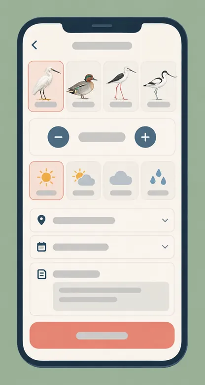
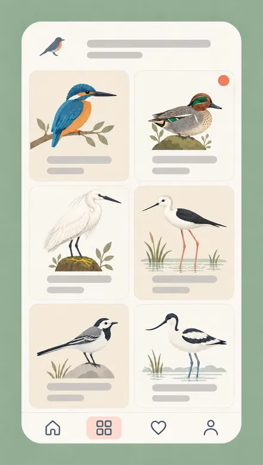

# 棲枝日誌：按鈕大到戴觸控手套也點得到的賞鳥紀錄

**手機 App 設計，八週。** 在測試中，登錄一筆目擊紀錄的時間中位數，從 48 秒降到 19 秒。

## 問題：賞鳥人回到家才登錄，已經晚了一天

這個賞鳥社團的志工，固定在一處河口濕地做鳥類數量調查。會員以前在筆記本上寫下目擊紀錄，回家再打進電腦，所以資料總是慢一天，而且一半的細節已經忘了。他們試過的 App 都是為坐在桌前設計的：表單很長，物種要靠鍵盤搜尋，太陽底下又看不清楚螢幕。

## 我的角色

我負責產品設計：現場訪查、紙上線框稿、介面設計和可點擊原型，還有視覺風格。程式由一位工程師開發，另有一位志工鳥類專家確認物種清單。我沒有寫程式，也沒有決定社團要怎麼運用這些紀錄。

## 過程

### 動筆之前，先看大家怎麼登錄

我在濕地待了兩個早上，跟五位會員一起走。三件事每次都一樣：他們趁鳥還在視線內趕快記錄，一年有一半時間戴著觸控手套，而且水邊的手機訊號時有時無。所以登錄一筆紀錄，要能在「鳥飛走之前」完成。

### 先畫在紙上，和會用的人一起畫

一張紙上畫三支手機：地圖、新增目擊紀錄和圖鑑收藏。我們拿著這張紙和一枝鉛筆在濕地走了一圈，會員直接在上面打勾。把物種選擇移到表單最上面，就是一段十分鐘的路上定下來的。

:::annotate[紙上線框稿]

- {#1 region x=17% y=29% w=21.6% h=53.2%} 地圖：觀察亭、步道，還有每一筆目擊紀錄的位置。
- {#2 region x=39.3% y=27.8% w=22.5% h=51.4%} 新增目擊紀錄的表單，物種在最上面。
- {#3 region x=60.6% y=26.9% w=22.5% h=48.4%} 圖鑑收藏格。
- {#4 pin x=45.9% y=37.8%} 把物種選擇移到這裡，是拿著這張紙和一枝鉛筆走十分鐘路定下來的。
:::

### 物種用圖，數量用大按鈕

手指凍僵的時候打「小水鴨」三個字很折磨。所以表單一打開，是一排插畫物種按鈕，放會員最常記的幾種鳥，完整清單點一下就展開。數量有大大的加減號，天氣只要從四個圖示裡點一個。

:::annotate[新增目擊紀錄表單]

- {#1 region x=13.5% y=15.6% w=72.6% h=13.6%} 插畫物種按鈕，放會員最常記的幾種鳥，完整清單點一下就展開。
- {#2 region x=14.4% y=31% w=70.4% h=11.5%} 數量是大大的加減號，凍僵的拇指也按得到。
- {#3 region x=14.4% y=41.8% w=70.4% h=10.3%} 天氣只要從四個圖示裡點一個。
- {#4 region x=14.4% y=83.6% w=70.9% h=9.2%} 一顆珊瑚紅的儲存按鈕，是整個畫面唯一強烈的顏色。
:::

### 收藏圖鑑是唯一的獎勵

整個 App 唯一有遊戲感的地方，是一面隨著記錄越來越多而填滿的圖鑑格。新物種會在角落出現一個小小的珊瑚紅徽章，不會催人。

:::annotate[圖鑑收藏]

- {#1 pin x=85% y=18.2%} 新物種會在角落出現一個小小的珊瑚紅徽章，不會催人。
- {#2 region x=11.1% y=15% w=78% h=73.3%} 隨著記錄越來越多而填滿的圖鑑格，是整個 App 唯一有遊戲感的地方。
:::

## 我捨棄了什麼，為什麼

- **用照片辨識鳥種。** 想法很棒，但場合不對：等你拍完照，鳥早就飛走了。社團寧可要誠實的「不確定」，也不要信心滿滿的錯誤答案。
- **社群動態。** 會員很明白地說，不想看到彼此的清單，只想看這片濕地的總數。
- **用顏色標示稀有程度。** 結果大家只記稀有的鳥，不記麻雀，這會害整體統計失真。

## 成果

:::key-numbers{title="原型測試，5 位會員"}
- 19 秒｜登錄一筆紀錄的時間中位數｜之前 48 秒
- 5 人中 4 人｜鳥還在視線內就完成登錄｜之前 5 人中 1 人
- 10 筆中 0 筆｜沒有填物種的紀錄｜之前 10 筆中 3 筆
:::

測試版在春天發給社團的 212 位會員。會計最先要的是每週統計的匯出功能，所以這是下一個要做的工作。

在「合輯」裡打開「棲枝日誌畫面」，可以把線框稿和三張完成的畫面放在同一排看。
