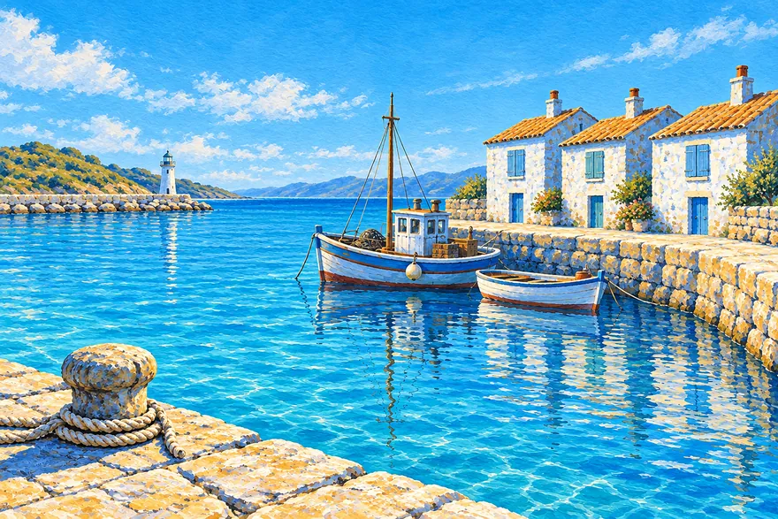

# 小港灣

同一座漁港，在一天裡畫了四次。個人系列，不透明水彩畫在棉質紙上，A4 尺寸，每一張各有自己的限定色盤。

## 黎明

粉紅和淡藍，平靜的水面，前景碼頭上盤著一圈繩子。四張裡最暖的一張，也是我第一個畫的，用來決定漁港的形狀。

## 正午

用土耳其藍、鈷藍、土黃和一點點紅，再加白。我要碼頭的石頭看起來很燙，所以讓陰影走深藍，不走灰色。

## 霧

灰色和鼠尾草綠，一盞暖色的燈是畫面唯一的亮點。四張裡最安靜的一張，也是大家最先問起的。

## 夜

墨藍和藍綠，對上黃色路燈，加一艘紅色的船當作小小的意外。倒影是濕畫法一次畫成的，所以這一張我畫了三次才留下來。

## 這個系列怎麼運作

- **同一個視角，不同的光。** 漁港的格局不動，改變的是時間、天氣和色盤。
- **每張一組色盤。** 三到四個顏色加白色，事先調好，畫面才不會跑掉。
- **沒有人。** 這座港口屬於船。

## 版畫與委託

印在純棉紙上的微噴版畫，A4 和 A3 兩種尺寸，每張限量 50 版。客製的漁港，也就是把你愛的小鎮，畫成你記得的那個時刻，大約需要三週。

在「合輯」裡打開「小港灣」，四張畫並排成一列，一天的光線就從左讀到右。
