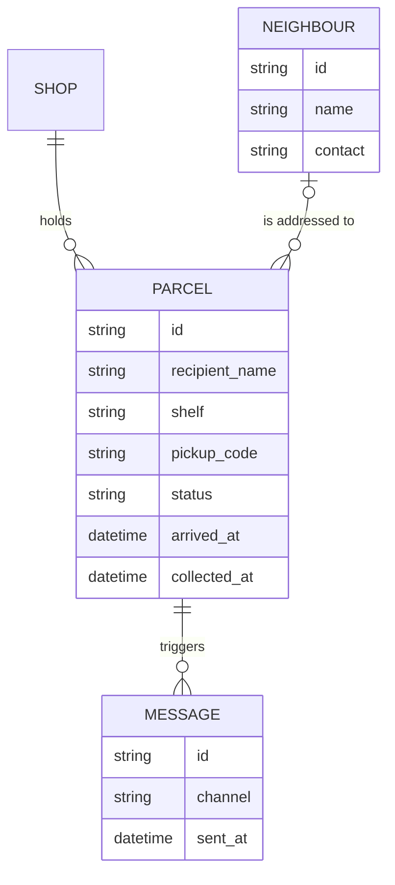

# Data model

Four things to store: shops, neighbours, parcels and the messages sent about them.

## Notes on the fields

- `status` is one of *waiting*, *collected* or *returned*.
- `pickup_code` is six digits and unique among waiting parcels in one shop.
- A neighbour is optional. A shopkeeper can check in a parcel for a name nobody has registered.

See [Pickup flow](spec-pickup-flow.md) for how these fields change.
