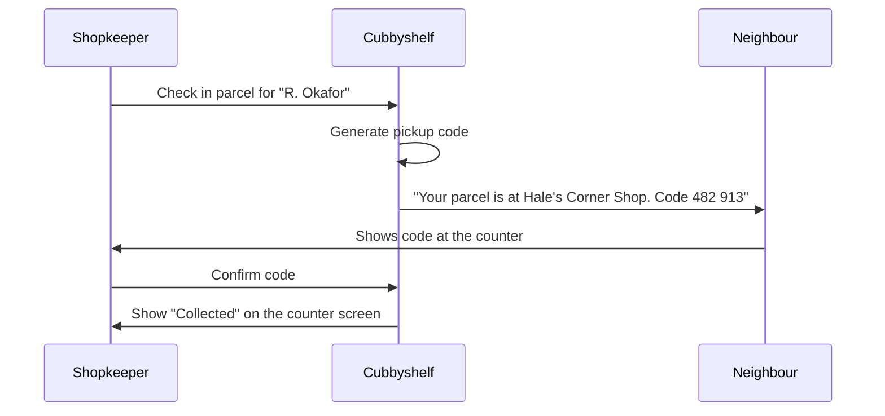

# Notifications

A neighbour should know the parcel is here before they walk to the shop.

A neighbour gets at most two messages per parcel: the pickup message and, after three days, one reminder. Collection is confirmed on the counter screen, not by message.

## Acceptance criteria

- [x] A message is sent within one minute of check-in.
- [x] The message names the shop and carries the code.
- [ ] One reminder goes out after three days if the parcel is still waiting, and never a second.
- [ ] A neighbour can turn reminders off, but never the first message.

## Not in this version

Delivery receipts, a preferred language per neighbour, and push notifications for neighbours who install the app (a later channel, after SMS). All three are on the backlog.

Related: [Pickup flow](spec-pickup-flow.md).

*This is a sample notebook from [MyGitNotes](https://mygitnotes.com/). [What this example shows](https://mygitnotes.com/use-cases/project).*
