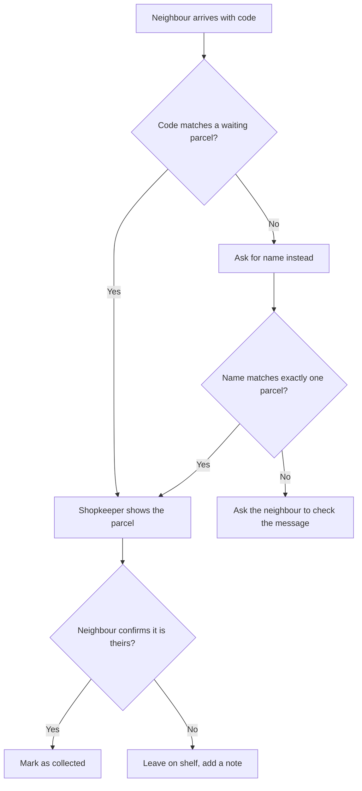

# Pickup flow

How a parcel gets from the shelf to the neighbour's hands.

## Rules

- A code works once. After a parcel is collected, its code is dead.
- Name matching is a fallback, never the first choice, because two neighbours can share a name.
- Collecting a parcel never deletes it. It leaves the waiting list and stays in the history.

## Open questions

- What if a neighbour sends someone else to collect? Probably a code is enough, but the shopkeeper should see who the parcel is for.
- Should the shopkeeper be able to override a mismatch? Leaning no for v1.1.
- Should the shopkeeper ask for ID when matching by name? Otherwise anyone can collect a parcel by saying a name.

Related: [Data model](data-model.md) and [Notifications](spec-notifications.md).

*This is a sample notebook from [MyGitNotes](https://mygitnotes.com/). [What this example shows](https://mygitnotes.com/use-cases/project).*
