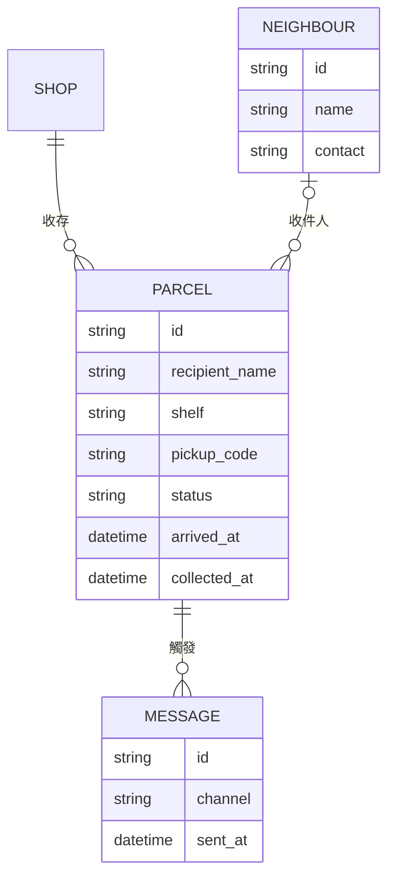

# 資料模型

要存四樣東西：店家、鄰居、包裹，以及為包裹發出的訊息。

## 欄位說明

- `status` 是 *waiting*、*collected* 或 *returned* 其中一種。
- `pickup_code` 是六位數字，在同一家店的等待中包裹裡不重複。
- 鄰居是選填。老闆可以替一個沒人註冊過的名字登記包裹。

這些欄位怎麼變化，見[取件流程](spec-pickup-flow.md)。

*這是 [MyGitNotes](https://mygitnotes.com/zh-tw) 的範例筆記本。[這個範例在示範什麼](https://mygitnotes.com/zh-tw/use-cases/project)。*
