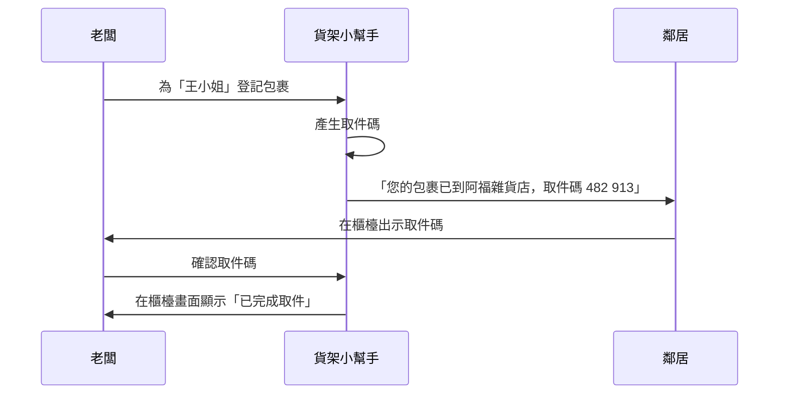

# 通知

鄰居應該在走去店裡之前，就知道包裹到了。

每個包裹，鄰居最多收到兩則訊息：到貨通知，以及三天後的一則提醒。取件完成只在櫃檯畫面確認，不另外發訊息給鄰居。

## 驗收條件

- [x] 登記後一分鐘內送出訊息。
- [x] 訊息寫明店名，並附上取件碼。
- [ ] 包裹放了三天還沒取，再提醒一次。
- [ ] 鄰居可以關閉提醒，但第一則訊息一定會送。

## 這一版不做

送達回執、每位鄰居自選語言，以及 LINE 官方帳號和 App 推播這兩個之後再加的管道（先用簡訊）。這幾項都在待排。

相關：[取件流程](spec-pickup-flow.md)。
