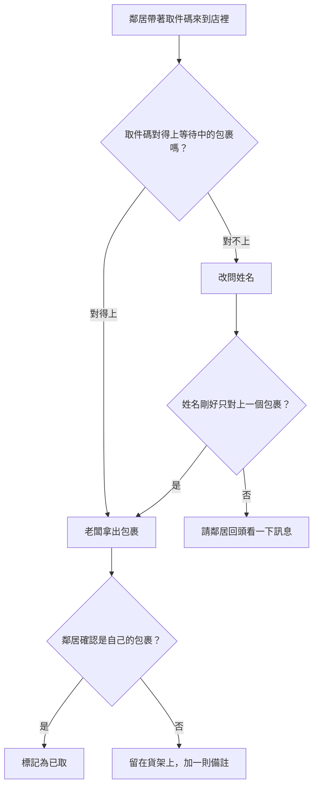

# 取件流程

包裹怎麼從貨架到鄰居手上。

## 規則

- 一組取件碼只能用一次。包裹取走之後，取件碼就失效。
- 比對姓名只是備案，不是第一選擇，因為兩位鄰居可能同名。
- 取件不會刪除包裹。包裹離開等待清單，但會留在歷史紀錄裡。

## 待釐清的問題

- 鄰居請別人代領怎麼辦？有取件碼應該就夠了，但老闆要看得到這個包裹是寄給誰的。
- 老闆可不可以在對不上時強制放行？1.1 版傾向不行。
- 用姓名比對時，要不要請鄰居出示證件？不然任何人報出名字就能領走包裹。

相關：[資料模型](data-model.md)和[通知](spec-notifications.md)。
