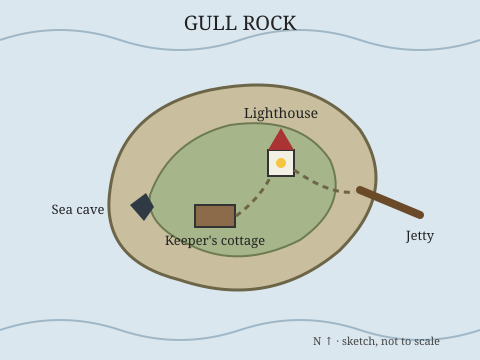

# Map of Gull Rock

The map is a plain SVG file kept in the notebook, so it is versioned like any note and needs no outside service.

## Key places

- **Jetty.** Where the boat lands. Slippery in the fog (DEX roll to avoid falling in).
- **Lighthouse.** Door unlocked. The lamp room is at the top; the [lower door](clue-lower-door.md) is behind the oil store.
- **Keeper's cottage.** The kitchen table is laid for two. Search it for the [logbook pages](clue-logbook-pages.md).
- **Sea cave.** Only reachable at low tide. This is where [the humming](clue-humming.md) is loudest.

Play it at the table next to the [outline](scenario-outline.md).

*This is a sample notebook from [MyGitNotes](https://mygitnotes.com/). [What this example shows](https://mygitnotes.com/use-cases/trpg).*
