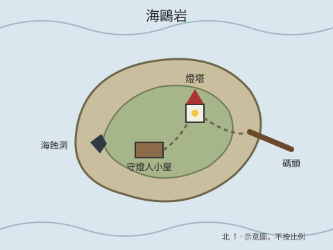

# 海鷗岩地圖

地圖是一個放在筆記本裡的 SVG 檔，和筆記一樣有版本紀錄，不用借助外部服務。

## 重點地點

- **碼頭。** 船在這裡靠岸。起霧時很滑，要擲敏捷才不會掉進水裡。
- **燈塔。** 門沒鎖。燈室在頂樓，[地下鐵門](clue-lower-door.md)藏在油料儲藏室後面。
- **守燈人小屋。** 廚房的桌上擺了兩人份的餐具，抽屜裡有[守燈日誌](clue-logbook-pages.md)。
- **海蝕洞。** 只有退潮時進得去，[低鳴聲](clue-humming.md)在這裡最響。

開團時放在[劇情大綱](scenario-outline.md)旁邊。
